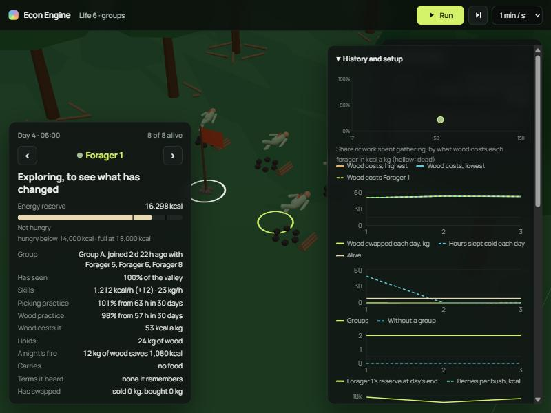

# Econ-Engine

A deterministic agent-based economy you can watch and inspect in the browser: 100 households, nine firms and a Government, with every cent accounted for. Every run is reproducible from its seed.

**[▶ Open the live simulator](https://neolorenzo.github.io/Econ-Engine/)**. It runs entirely in your browser; there is nothing to install.

Current model: MVP9, multi-tile plots. The [changelog](CHANGELOG.md) records every update.


## What you can explore

The simulator opens on a 3D town. Each house is a household, from a shack to a villa as its cash grows. Each firm's building fills its plot of land and shows its industry (a market hall for Food, a plant for Utilities, a clinic for Healthcare, a cinema for Entertainment), and its roof shows which firm it is. The Transport depot has its own plot, and Government's domed hall, on the largest plot, stands at the centre. Grass, trees and a ring of forest surround the town; the Scenery switch hides them. The Data overlay switch adds a translucent cash pillar around every house and colours the floor by which firm is cheapest where. Headline numbers float above it. Click anything to inspect it. Each section opens as a panel over the world, which stays live beside it, and "Locate" in a panel flies the camera to that household or firm.

| Section | What it shows |
| --- | --- |
| **Overview** | The day's money circuit between households, firms and Government, a plain-language feed of notable changes, and every market at a glance. |
| **Markets** | The four consumer markets (Food, Utilities, Healthcare, Entertainment): each firm's price, share, sales and wages, a top-down map of who bought where, and price, share and earnings over time. |
| **Households** | Every household's cash before and after redistribution, wages, purchases and employer, searchable and sortable. |
| **Government** | The current wealth-tax rate and how the Government's trials moved it, what it collected and paid back, and inequality before and after. |
| **Experiments** | Longer-run research questions, replayed from day 0 in a background worker without touching the live run. |


### Research questions

The Experiments section answers each question for the current seed:

- **Does the Government matter?** The adaptive wealth tax against no Government, over 1,000 days.
- **Who wins each market?** How often market leadership changes hands, and each firm's share, price and revenue over 1,000 days.
- **Jobs and wealth over time.** Every household's and employer's 1,000-day trajectory: who stays poor, who gets ahead, and why purchases fail.
- **Small vs large economy.** The same seed at 10 and 100 households, compared per household.

**Across many seeds.** One seed is one random path. The ensembles rerun the scale, Government and competition questions on 4, 8 or 16 seeds in parallel. They report the mean, standard deviation, middle 80% and range of each outcome, with every seed's value one click away.


How each mechanism works and how it was validated is in the [MVP 8 specification](docs/MVP8_SPEC.md), the [architecture notes](docs/ARCHITECTURE.md) and the [validation guide](docs/VALIDATION.md).

## Run locally

```bash
npm install
npm run dev
npm run lint      # oxlint and the Prettier check
npm run format    # apply Prettier
npm run test:run
npm run typecheck
npm run build
npm run check     # lint, typecheck, tests, and build
```

## Model at a glance

- One hundred households have fixed seeded employment and persistent cash.
- Eight competitive consumer firms each employ ten workers and produce 50 units per day; monopoly Transport employs 20 workers.
- The town is a 40×40 grid. Each household lives on one tile; each firm and Government stands on a plot sized by what it is, from 3×2 for a clinic to 5×5 for Government. A trip to a shop is measured to the nearest edge of its plot and costs 1¢ per tile, round trip.
- Households choose by delivered cost within percentage expenditure budgets. Purchases pay firms; contractual payroll is capped by cash and residual profit is taxed explicitly.
- Government acts only after payroll, starts at 0%, and tests seeded 0–100% wealth-tax alternatives.
- Tax rates use integer basis points; liabilities use floor-to-cent rounding.
- Every receipt returns explicitly through deterministic means-tested water filling. Government cannot borrow or create money.
- Money uses integer cents and remains exactly household count × $50 ($5,000 canonically). Live histories remain bounded; finite research harnesses retain full trajectory observations separately.

## Architecture

The pure TypeScript core in `src/sim` owns markets, employment/payroll, Government policy and fiscal transfers, events, metrics, experiments, ensembles, and invariants. React owns controls and presentation only, so the UI never changes economic behavior.

Read the current [MVP 8 specification](docs/MVP8_SPEC.md), [architecture notes](docs/ARCHITECTURE.md), [validation guide](docs/VALIDATION.md), and authoritative [simulation design rules](SIMULATION_DESIGN_RULES.md). Project evolution is recorded in the [changelog](CHANGELOG.md) and [lab notes](LAB_NOTES.md).

## Deployment

Pushes to `main` validate and deploy the static Vite bundle to [GitHub Pages](https://neolorenzo.github.io/Econ-Engine/).

## Current limits

Government is deliberately narrow and stylized: one flat cash-wealth tax, one Gini objective, no forecasting, and one equalizing transfer rule. There are no other taxes, benefits, public purchases, borrowing, money creation, monetary policy, or welfare/consumption objectives.

## Life: the bottom-up core

A second, separate simulation has started beside the MVP9 economy. It begins from the economy with the fewest institutions: foragers on a landscape of food patches that deplete and regrow, each with an energy reserve, living through day and night and deciding only from what it can see and remember. There is no money and no market. Each step up the [merge document's ladder](docs/MERGE.md#the-ladder) adds one thing and one question. Life 6, the current step, takes away the camp that held the band together. In a valley 600 m across, simulated minute by minute, people start scattered and know only what they have seen. Once fed and warm they explore, and they want company: two who meet found a group and plant a flag, anyone who meets a member joins, and members sleep around their flag and swap wood for food only with each other. As before, they pick berries bush by bush, gather deadwood under the trees, bring firewood home in loads, burn it at their own hearths against cold nights, and get better at what they do.

**[▶ Open Life 6](https://neolorenzo.github.io/Econ-Engine/life.html)**, also linked from the simulator's top bar. It works like a strategy game you watch but do not control: pause, step a minute, or run from real time up to a day a second; drag to pan, scroll or pinch to zoom from the whole valley down to one person, and right-drag or press Q and E to turn. Everything is drawn at true size: people about 1.75 m tall walk between bushes, reach into them to pick, stoop under the trees for deadwood, carry a bundle home on their backs and lie down by their hearths at night. Each person is coloured by what they are relatively good at, from cyan for gathering wood to gold for picking, and wears a band across the chest in their group's colour, the colour of the group's flag. Click a person to follow them and see their group, how much of the valley they have seen, and how practised they are at each task; ground they have never seen is drawn darker. Click a bush or tree to compare what it really holds with what that person remembers, and a flag to see its group. Only the current step has a page; the earlier steps live on in the tests.



The results so far:

- **Life 0, alone.** A forager that knows only what it last saw survives with food supplies just 6–14% above the theoretical minimum. With no one else eating, a remembered patch can only have grown, so stale memory errs in the safe direction.
- **Life 1, a band.** The band does not settle at the number the land could feed. A band of 40, on land that could feed about 20, collapses to 4–8 within two weeks. Hungry foragers spend their days walking to patches others have emptied, and walking costs more than the land regrows. Even knowing every patch's stock does not prevent it.
- **Life 2, sharing.** Uneven harvests kill: a band of 12 that lives on steady harvests loses half its members within 400 days when food comes as windfalls of 6,000 kcal, mostly to runs of bad luck. Bands that share keep more alive (6.9 against 5.7), though only about 4% of food changes hands. Within a mixed band, keepers live off the sharers' gifts, yet no strategy clearly outlives the others: a sharer gives only what its body cannot hold, so sharing costs it almost nothing.
- **Life 3, specialization.** Foragers with different skills come to specialize by comparative advantage once they can swap: those for whom wood is cheap gather it for those for whom it is dear, and half the wood burned has been bought. A band of 8 keeps 7.5 alive with swaps against 6.9 without, and the least skilled third survives 80% of the time instead of 52%. But exchange does not start by itself. With steady harvests no forager carries spare food, and no swap ever happens unless foragers tell each other the terms they would accept.
- **Life 4, practice.** Foragers born alike divide their work once skill grows with practice and they can swap: in every band one or two become wood gatherers and the rest buy wood from them, starting from small differences that chance opens up within the first few weeks. Practice alone, without exchange, leaves everyone alike. Roles change hands: a lead gatherer keeps the job for months, and how long depends on how long skill is remembered, with roles turning over constantly at 10 days of memory and hardly changing at 90.
- **Life 5, real scale.** At real scale, exchange never starts unless people bring home more firewood per trip than they keep, because they can stop gathering the moment they have enough. In Life 3 and Life 4 the spare wood that started trade came from the lumps of hourly work. With 30 kg loads, a band born alike still divides its work, but far later and less sharply than in Life 4 (the first swap around day 140 instead of 15). Some loads keep everyone's routine in step, so nobody has wood to spare when anyone needs it, and trade never starts. Walking costs minutes instead of hours, so the valley keeps a band of 12 alive where Life 4's land could not.
- **Life 6, groups.** People who start scattered and want company form groups within their first day, but a band of 8 usually splits: into one group in 6 runs of 32, two in 19, three in 6 and four in 1, because whoever has company stops looking. Splitting costs trade, since groups swap only among themselves: members of scattered groups buy 12% of the wood they burn, against 18.5% in a band that starts as one group, and the more groups, the less they buy and the less they divide their work. Exploring every day costs about two and a half hours of walking, which a band of 8 or 12 can pay but a band of 16 cannot.

Details are in the [Life 0](docs/LIFE0_SPEC.md), [Life 1](docs/LIFE1_SPEC.md), [Life 2](docs/LIFE2_SPEC.md), [Life 3](docs/LIFE3_SPEC.md), [Life 4](docs/LIFE4_SPEC.md), [Life 5](docs/LIFE5_SPEC.md) and [Life 6](docs/LIFE6_SPEC.md) specifications and the [lab notes](LAB_NOTES.md).

## Direction

The long-term aim is an institution-agnostic engine: markets, taxes, governments and other institutions should emerge from agents' decisions instead of being built in. The [vision document](docs/VISION.md) describes that direction. The [merge document](docs/MERGE.md) records the decision to merge Life Engine into this project and build a new core bottom-up, starting from a band of foragers. Neither is a description of the current model.
